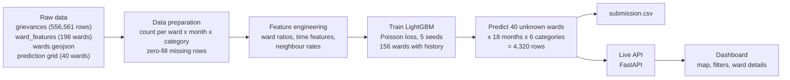
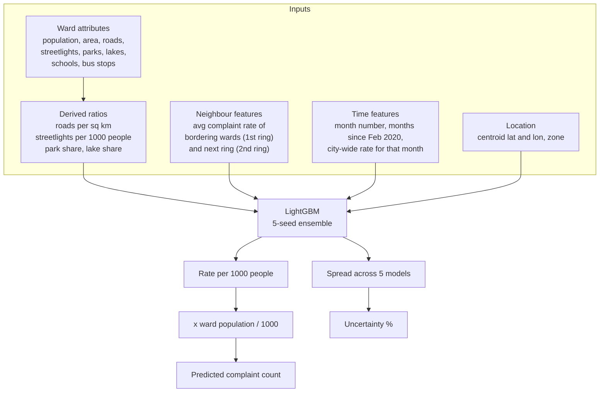
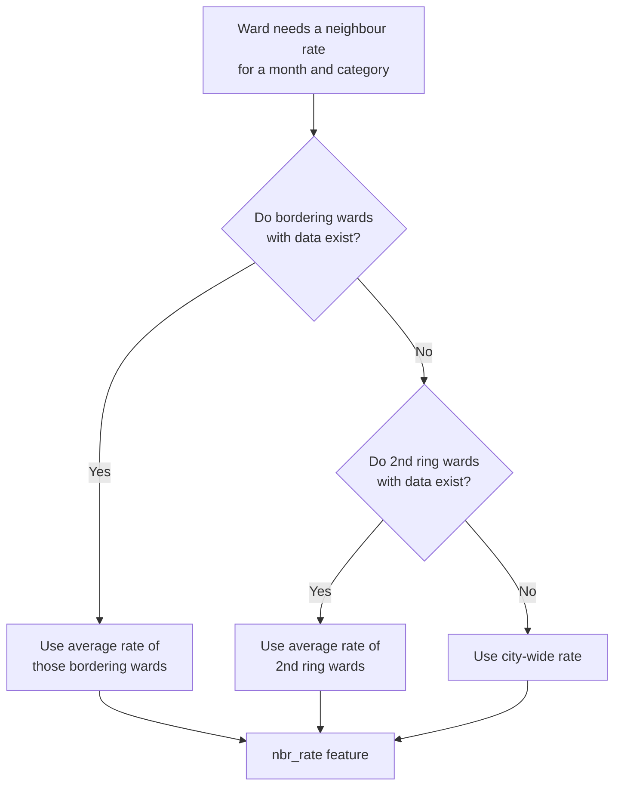
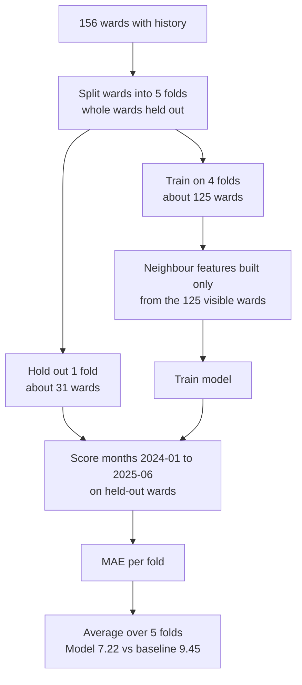
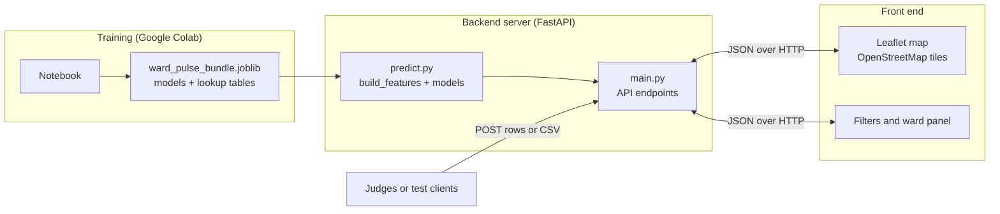
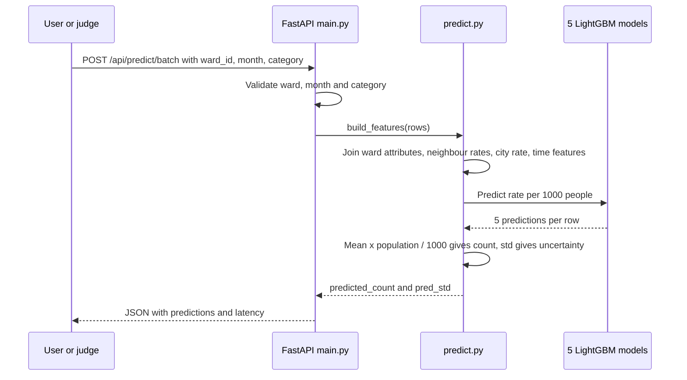
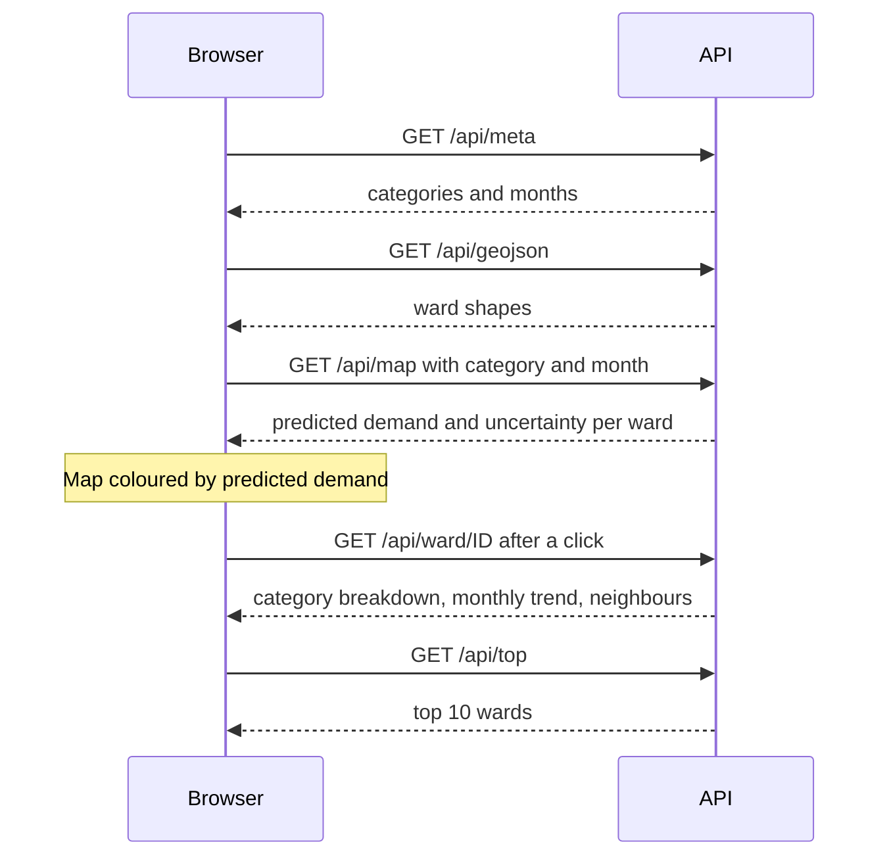
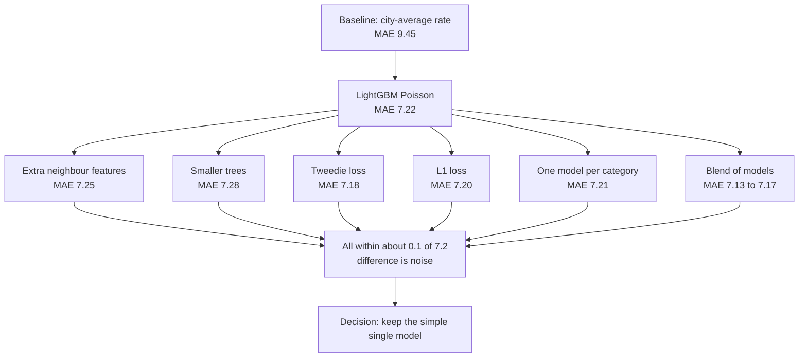
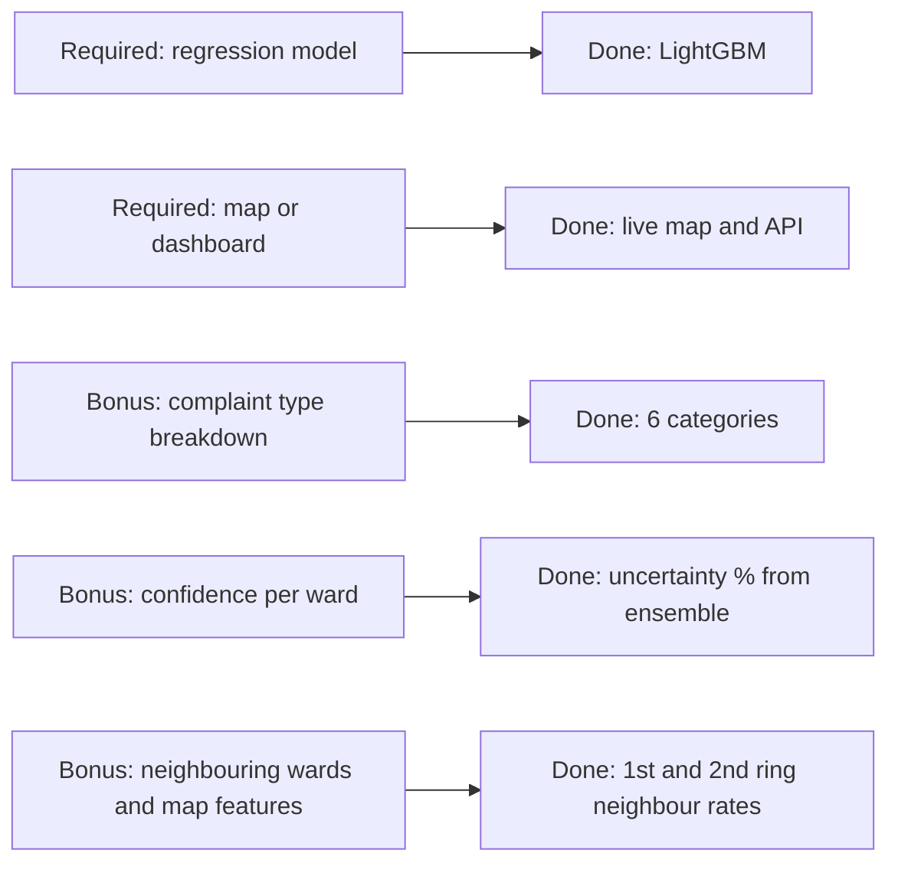

My deployed website is : https://wardpulse2.vercel.app/
# Ward Pulse - Civic Demand & Complaint Prediction Platform

## 2. What the model learns from

## 3. Neighbour feature logic

## 4. Validation: testing on wards the model never saw

## 5. System architecture

## 6. Live prediction request

## 7. Dashboard interaction

## 8. Experiments and decision

## 9. Requirements checklist

